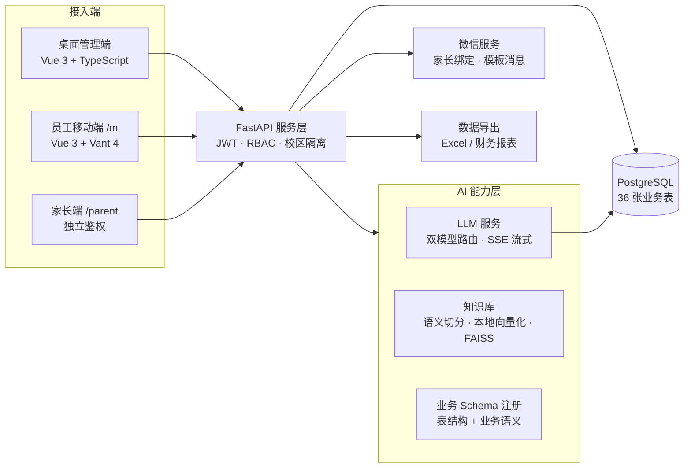

# AI 教务中心 · 技术展示

> 面向少儿编程教育机构的教务中台 + AI 助手，独立设计与开发。
>
> **本仓库为脱敏技术切片**：展示架构设计与核心实现思路，不含任何真实用户数据、业务数据与生产配置。

---

## 项目概览

机构原使用 Excel 与通用 SaaS 管理学生、排课与课时，数据分散、对账困难。本项目从 0 到 1 自建教务中台，覆盖「招生报名 → 排课 → 签到扣课时 → 续费/转课 → 缴费 → 教师课酬核算」全流程，并在此基础上接入大模型，做成员工可直接使用的 AI 助手。

| 指标 | 数值 |
|---|---|
| 服务学员 / 班级 | 625 人 / 109 个 |
| 累计上课记录 | 6.8 万条 |
| 日常使用者 | 20+ 名教师与管理人员 |
| 初版交付周期 | 一个多月（独立完成） |
| 后端接口 | 197 个（26 个路由模块） |
| 前端页面 | 53 个 |
| 数据库 | PostgreSQL，36 张表，31 次 Alembic 迁移 |
| AI 月成本 | 约 200-300 元（含服务器） |

**我的角色**：独立负责需求调研、数据建模、前后端开发、AI 能力落地、部署与运维。

---

## 系统架构

### 三端形态

| 端 | 使用者 | 核心场景 | 技术 |
|---|---|---|---|
| 桌面管理端 | 校长、教务、财务 | 全量管理、统计、薪酬核算 | Vue 3 + TS + Pinia + Element Plus |
| 员工移动端 `/m` | 教师、组长 | 课堂现场签到扣课时、查学生、看课表 | Vue 3 + Vant 4 |
| 家长端 `/parent` | 学生家长 | 剩余课时/学费、出勤记录、到期提醒 | Vue 3，独立 `parent_token` 鉴权 |

> 三端共用一套代码库，通过路由前缀与布局分流，不维护多套工程。

---

## 核心能力

1. **教务全流程闭环**：学生/班级管理、排课、签到自动扣课时（含误触撤回）、续费与转课（审计留痕）、缴费记账、教师课酬自动核算
2. **AI 助手（两类能力）**
   - 知识库问答：制度、操作规范入库，老师直接提问即可自助查询
   - 数据问答：自然语言 → 只读 SQL → 业务洞察，支持按角色与校区做行级数据隔离
3. **家长端服务**：课时余额、出勤状态、课包到期提醒，降低家校沟通成本
4. **权限体系**：多角色 RBAC（超管/校长/校区管理员/组长/教师/销售/财务）+ 校区级数据隔离

---

## 关键技术决策

### 1. RAG：按语义边界切分，而不是按固定字数切

知识库内容为按功能模块编写的 Markdown 文档，每个 `##` 二级标题对应一个完整功能点或规则。

- **切分**：以 `##` 为语义边界切块，保证检索命中的是一块完整规则，而不是被拦腰截断的半句话
- **向量化**：`BAAI/bge-small-zh-v1.5`（512 维），通过 `fastembed` **本地推理，零外部 API 依赖、零 token 成本**
- **检索**：FAISS `IndexFlatIP` + L2 归一化（归一化后内积等价于余弦相似度），`top_k=5`
- **可溯源**：每个切片携带文档标题、所属分组、章节标题与序号，回答可定位来源
- **工程细节**：索引重建加线程锁；FAISS 在 Windows 下不兼容中文路径，索引文件统一存放于英文路径

### 2. 双模型路由：效果与成本的平衡

- 接入 **GLM-5.2（阿里云百炼）** 与 **DeepSeek** 两个 Provider，统一封装为 OpenAI 兼容接口
- 按任务类型路由：复杂分析走能力更强的模型，常规问答走低成本模型
- 流式输出使用 SSE，同时回传 token 用量，便于成本核算

### 3. Text-to-SQL 的三道安全边界

让 AI 查业务数据，最大的风险是权限与误操作：

1. **只读**：只允许 `SELECT / WITH` 开头的语句，执行前做语法白名单校验
2. **表结构注册**：将 30+ 张业务表按业务域注册，并附中文说明，让模型理解「课酬」「流失」等业务术语对应哪张表
3. **行级隔离**：根据登录角色与校区，在 System Prompt 中注入强制的 `WHERE campus_id = ?` 规则，教师/销售等角色只能看到授权范围内的数据；查询结果限制最多 100 条

### 4. 签到扣课时：把业务规则做成事务

- 签到不是简单写一条记录：需要按「课程/科目 → 校区 → 常规课包 → 兜底」四级策略匹配学生的课包，再解析课时数（班级设定 > 课程设定 > 默认值）
- 扣减课包与写签到记录在同一事务内完成；支持误操作撤回（软删除留痕）
- 家长微信通知异步化，通知失败不阻塞签到主流程

### 5. 一套代码，三端分流

- 路由前缀区分端：桌面端 `/`、员工移动端 `/m`、家长端 `/parent`
- 移动端底部 Tabbar 按角色动态渲染，与后台权限点共用同一套 `allowedKeys`
- 家长端使用完全独立的 `parent_token`，与员工鉴权体系隔离，家长只能访问自己孩子的数据

---

## 代码样例

> 以下为脱敏后的核心实现片段（依赖的配置、模型定义已省略），用于展示代码风格与设计思路。

### 后端

| 文件 | 展示内容 |
|---|---|
| [`code-samples/backend/knowledge_service.py`](code-samples/backend/knowledge_service.py) | RAG 知识库：Markdown 语义切分、本地向量化、FAISS 索引与检索 |
| [`code-samples/backend/ai_service.py`](code-samples/backend/ai_service.py) | 双模型 Provider 封装、流式输出、Function Calling |
| [`code-samples/backend/ai_service_schema.py`](code-samples/backend/ai_service_schema.py) | 业务表 Schema 注册：让 LLM 理解业务语义 |
| [`code-samples/backend/ai_chat.py`](code-samples/backend/ai_chat.py) | AI 助手路由：角色/校区行级隔离、只读 SQL 校验、SSE 流式返回 |
| [`code-samples/backend/checkin_service.py`](code-samples/backend/checkin_service.py) | 签到业务：课包四级匹配、课时解析、通知降级 |

### 前端

| 文件 | 展示内容 |
|---|---|
| [`code-samples/frontend/useMobile.ts`](code-samples/frontend/useMobile.ts) | 移动端路由判定、按角色过滤 Tabbar、详情页隐藏逻辑 |
| [`code-samples/frontend/MobileLayout.vue`](code-samples/frontend/MobileLayout.vue) | Vant 移动端骨架：动态导航栏与底部标签栏 |
| [`code-samples/frontend/mobileTabbar.ts`](code-samples/frontend/mobileTabbar.ts) | 移动端导航配置 |
| [`code-samples/frontend/home.vue`](code-samples/frontend/home.vue) | 家长端首页：多孩切换、课包到期提醒、剩余学费 |
| [`code-samples/frontend/mobile-student-index.vue`](code-samples/frontend/mobile-student-index.vue) | 移动端学生管理：表格 → 票卡式布局适配 |

---

## 工程与部署

- **后端**：FastAPI + SQLAlchemy + PostgreSQL，Alembic 管理迁移
- **前端**：Vue 3 + TypeScript + Pinia，Vite 构建
- **部署**：Docker Compose 编排（PostgreSQL + FastAPI + Nginx），每日定时备份
- **成本**：单台云服务器即可承载，AI 调用按月 200-300 元量级

---

## 说明

- 本仓库中的代码来自公司内部项目的**脱敏片段**，已移除：真实学员/家长信息、生产配置与密钥、真实财务数据、品牌与校区标识
- 仅用于个人技术能力展示，不代表公司授权开源；如需了解完整项目，可另行沟通
- 截图见 [`screenshots/`](screenshots/)，均为脱敏后的演示数据

---

## 联系

- 邮箱：（待填写）
- 简历：（待填写）
