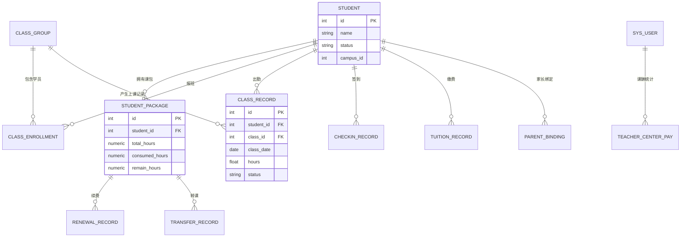
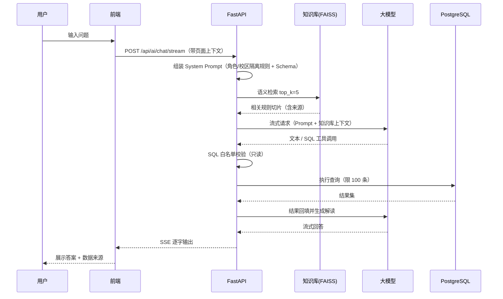
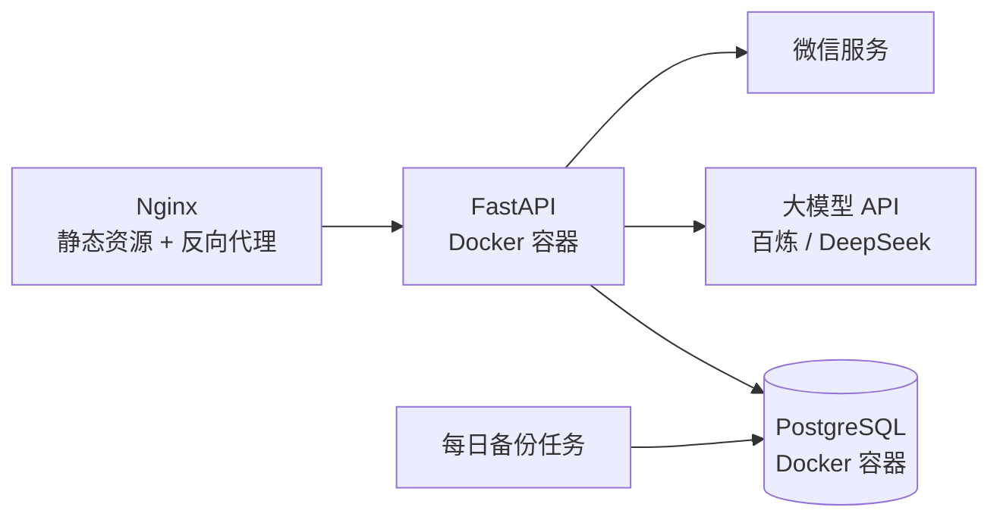

# 架构与设计说明

> 本文档说明系统的模块划分、数据模型与关键链路设计。所有示例均已脱敏。

## 1. 模块划分

后端按业务域拆分为 26 个路由模块，核心分组如下：

| 业务域 | 模块 | 说明 |
|---|---|---|
| 认证与权限 | `auth` / `users` | JWT 登录、角色与权限点、校区归属 |
| 学员 | `students` / `student_flow_record` | 学员档案、在读状态、流转记录 |
| 班级与课程 | `classes` / `courses` / `groups` | 班级、课程体系、课程进阶、分组 |
| 排课与签到 | `schedules` / `checkin` | 排课规则、排课实例、签到扣课时、签到异常处理 |
| 课包与财务 | `renewals` / `transfers` / `payments` / `refund_detail` | 续费、转课、在线支付、退费 |
| 课酬核算 | `teacher_center_pay` / `trial_class_detail` / `part_time_class_detail` / `external_class_detail` | 教师月度课酬、试听/兼职/外课明细 |
| 家校服务 | `parent` / `wechat_bind` / `notifications` | 家长端、微信绑定、消息通知 |
| AI 能力 | `ai_chat` / `knowledge` | AI 助手、知识库管理 |
| 数据看板 | `dashboard` / `export_service` | 经营数据统计、Excel 导出 |

## 2. 数据模型（核心表）

## 3. AI 助手链路

### 设计要点

1. **知识库与数据问答是两条互补路径**：制度类问题走 RAG，业务数字类问题走 Text-to-SQL；System Prompt 中同时注入两类上下文
2. **权限必须发生在数据库之前**：模型生成的 SQL 会先经过只读校验，再叠加角色/校区的行级约束（通过 Prompt 强制 + 应用层校验）
3. **成本控制**：本地 embedding（零 API 成本）+ 低成本对话模型 + 历史轮数截断（保留最近 6 轮）

## 4. 权限模型

| 角色 | 数据范围 |
|---|---|
| 超级管理员 | 全量 |
| 校区校长 / 校区管理员 | 本校区 |
| 组长 | 本组教师及关联班级/学员 |
| 教师 | 自己带班的班级、学员与上课记录 |
| 销售 / 财务 | 按业务域授权 |

- 前端：登录后写入 `allowedKeys`，路由守卫与移动端 Tabbar 均基于权限点过滤
- 后端：接口级校验 + 查询条件级校区过滤

## 5. 部署拓扑

- 单机 Docker Compose 编排，Nginx 托管前端构建产物并反向代理 API
- Alembic 管理数据库迁移；每日凌晨自动备份，保留 7 天
- 通过环境变量注入所有密钥，代码库不含任何生产凭据

## 6. 已知取舍与后续方向

- **知识库重建是全量的**：文档变更后重建整个索引；后续可做增量更新与版本化
- **Text-to-SQL 结果缺乏自动校验**：目前依赖只读约束与结果条数限制，后续可增加查询结果合理性校验
- **通知链路为异步降级**：微信通知失败不影响主流程，但缺少重试队列
- **移动端与桌面端存在部分重复视图**：后续可抽象共享业务组件，降低维护成本
